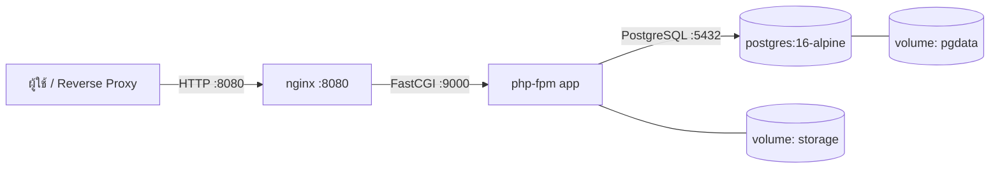

# คู่มือ Deploy — php-docflow

เอกสารนี้อธิบายวิธีรันและ deploy แอปพลิเคชัน **php-docflow** (PHP 8.5 + Twig + PostgreSQL) บนเครื่อง production แบบ Docker Compose พร้อมสคริปต์ใน `deploy/`

---

## 1. ภาพรวมสถาปัตยกรรม



| Service | Image / build target | Port | Volume | Healthcheck |
|---|---|---|---|---|
| `nginx` | `Dockerfile` → `web` (nginx 1.27-alpine) | `${APP_BIND_IP}:${APP_PORT}` → `8080` | – | `GET /api/healthcheck` ต้องเจอ `"status":"up"` |
| `app` | `Dockerfile` → `runtime` (php:8.5-fpm-bookworm) | 9000 (ภายในเท่านั้น) | `storage` → `/var/www/html/storage` | เปิด FPM port 9000 ได้ |
| `db` | `postgres:16-alpine` | 5432 (ภายในเท่านั้น) | `pgdata` → `/var/lib/postgresql/data` | `pg_isready` |

- ทุก service ใช้ `restart: unless-stopped`, `no-new-privileges:true`, `cap_drop: ALL`
- ลำดับรอ: `nginx` รอ `app` healthy → `app` รอ `db` healthy
- `/api/healthcheck` มีการ query `SELECT 1` จริง → ถ้า DB ล่ม nginx จะ unhealthy ด้วย

---

## 2. สิ่งที่ต้องเตรียมบน Host

- Docker Engine + **Docker Compose v2** (`docker compose ...` และต้องรองรับ `--wait --wait-timeout`)
- `git`, `bash`, `curl`
- Repo ถูก clone ไว้ที่ **`/srv/php-docflow`** (ตำแหน่งนี้ถูก hard-code ใน `deploy/common.sh`)
- สิทธิ์เขียน `/etc/php-docflow/` และ `/var/backups/php-docflow/`
- สำหรับ deploy อัตโนมัติ: self-hosted GitHub Actions runner ที่มี label `self-hosted linux x64 deploy` และ environment `production`
- Reverse proxy / SSL terminator ถ้าต้องการ HTTPS (nginx ใน compose เปิด plain HTTP เท่านั้น)

---

## 3. โครงสร้างไฟล์บน Host

```
/srv/php-docflow/                 # repo (ต้องมี commit ที่จะ deploy)
/etc/php-docflow/
  ├── app.env                     # ความลับ + config แอป (chmod 600) — ต้องสร้างเอง
  ├── compose.env                 # APP_IMAGE_TAG / APP_BIND_IP / APP_PORT (สคริปต์เขียนให้)
  ├── current-tag                 # short SHA ของ release ปัจจุบัน
  └── previous-tag                # short SHA ของ release ก่อนหน้า (ใช้ rollback)
/var/backups/php-docflow/
  └── db-YYYY-MM-DD_HHMMSS.sql.gz # backup DB ล่าสุด 14 วัน
```

> `deploy/*.sh` **ไม่มี executable bit** (mode 0644) → ต้องเรียกด้วย `bash path/to/script.sh` เสมอ

---

## 4. ตั้งค่า `/etc/php-docflow/app.env`

ไฟล์นี้ถูกใช้ 2 ทางพร้อมกัน:

1. เป็น `env_file` ของทั้ง service `app` และ `db`
2. ถูก mount แบบ read-only เป็น `/var/www/html/.env` ใน container `app`

ตัวอย่างสำหรับ production (PostgreSQL):

```dotenv
APP_ENV=production
APP_DEBUG=false
APP_TIMEZONE=Asia/Bangkok

DB_DRIVER=pgsql
DB_HOST=db
DB_PORT=5432
DB_NAME=php_docflow
DB_USER=php_docflow
DB_PASS=<strong-password>

# จำเป็นสำหรับ postgres:16-alpine (compose ส่ง env_file นี้ให้ db โดยตรง)
POSTGRES_USER=php_docflow
POSTGRES_PASSWORD=<strong-password>
POSTGRES_DB=php_docflow

SESSION_NAME=app_session
SESSION_SECURE=true
SESSION_LIFETIME=0

LOG_RETENTION_DAYS=14
LOG_MIN_LEVEL=ERROR
```

```bash
sudo mkdir -p /etc/php-docflow
sudo tee /etc/php-docflow/app.env > /dev/null <<'EOF'
# ... ใส่ค่าข้างบน ...
EOF
sudo chmod 600 /etc/php-docflow/app.env
```

**ข้อควรระวังสำคัญ**

- `DB_HOST` ต้องเป็น **`db`** (ชื่อ service) ไม่ใช่ `localhost`
- ต้องมี `POSTGRES_USER` / `POSTGRES_PASSWORD` / `POSTGRES_DB` ด้วย มิเช่นนั้น container `db` จะ initialize ไม่ได้
- `SESSION_SECURE=true` (default) → cookie จะถูกส่งเฉพาะ HTTPS ถ้าเปิด HTTP อย่างเดียวต้องตั้งเป็น `false` ชั่วคราว
- `APP_DEBUG=false` เสมอใน production (`true` จะโชว์ stack trace)
- ตัวแปร environment จริงจาก compose (`env_file`, `environment`, image `ENV`) จะ **ชนะ** ค่าในไฟล์ `.env` ที่ mount เข้าไป ดังนั้น `PDF_CHROME_PATH` / `PDF_NODE_MODULE_PATH` ที่ฝังใน image แก้โดยการแก้ `app.env` ไม่ได้ ต้อง override ผ่าน compose `environment:`
- `APP_URL` ไม่ได้ถูกโค้ดอ่านจริง (มีแค่ใน `.env.example`) อย่าใช้เป็นตัวกำหนด path ของ reverse proxy

`compose.env` จะถูกเขียนอัตโนมัติโดย `deploy.sh` / `rollback.sh`:

```dotenv
APP_IMAGE_TAG=<short-sha>
APP_BIND_IP=<ip>
APP_PORT=<port>
```

ค่าตั้งต้น: `APP_PORT=8080`, `APP_BIND_IP` ของ compose คือ `127.0.0.1` แต่ของ `deploy/common.sh` คือ `192.168.168.28` → ควรเขียน `compose.env` ให้ชัดเจนก่อน deploy ครั้งแรก

---

## 5. Deploy ครั้งแรก (Bootstrap)

```bash
cd /srv/php-docflow
git fetch --all && git checkout main && git pull --ff-only

# ตรวจว่าไฟล์ที่จำเป็นมีครบ
test -f /etc/php-docflow/app.env && echo OK
```

> ⚠️ **ห้ามรัน `deploy/verify.sh` บน host ที่มีข้อมูล production** — สคริปต์นี้ใช้ compose project เดียวกันและจบด้วย `docker compose ... down -v` ซึ่งจะลบ volume `pgdata` และ `storage` ทั้งคู่ ใช้เฉพาะบนเครื่องทดสอบแยกเท่านั้น

Deploy ( migrations ถูกรันให้โดยอัตโนมัติ ):

```bash
bash /srv/php-docflow/deploy/deploy.sh
# หรือระบุ commit ที่ต้องการ
bash /srv/php-docflow/deploy/deploy.sh <SHA>
```

ลำดับที่ `deploy.sh` ทำ:

1. `backup.sh` — dump DB เก็บไว้ก่อน
2. เขียน `compose.env` ให้ชี้ image tag ใหม่
3. `compose build nginx app`
4. `compose up -d --remove-orphans`
5. `compose exec -T app php bin/console migrate`
6. `wait_health()` — curl `/api/healthcheck` สูงสุด 30 ครั้ง × 2 วินาที
7. เขียน `previous-tag` / `current-tag`
8. `docker image prune -f --filter until=168h` (ลบ image ที่ไม่ใช้เก่าเกิน 7 วัน)

### สร้างข้อมูลเริ่มต้น (ทำครั้งเดียว — สคริปต์ deploy ไม่ทำให้)

```bash
COMPOSE="docker compose --env-file /etc/php-docflow/compose.env -f /srv/php-docflow/docker-compose.prod.yml"

$COMPOSE exec app php bin/console rbac:sync
$COMPOSE exec app php bin/console user:create \
  --email=admin@example.com --name="Admin" --role=admin
```

- `rbac:sync` upsert permissions จาก `config/rbac.php` และ role `admin` แบบ idempotent
- ไม่มีคำสั่ง `seed` แยกต่างหาก
- `user:create` ถามรหัสผ่านแบบ hidden → **ต้องใช้ TTY** (อย่าใช้ `exec -T`)
- ถ้าใช้ PDF/logo: `public/assets/imgs` ถูก gitignore ต้อง copy `logo2.jpg` เข้าไปใน image/host เอง

ตรวจสอบ:

```bash
curl -fsS "http://<APP_BIND_IP>:<APP_PORT>/api/healthcheck"
# {"success":true,"data":{"status":"up","database":"connected","timestamp":...}}
```

---

## 6. Deploy ปกติ / GitHub Actions

`.github/workflows/deploy.yml` ทำงานแบบ **workflow_run** ต่อจาก `CI` ที่สำเร็จบน branch `main` เท่านั้น:

```yaml
runs-on: [self-hosted, linux, x64, deploy]
environment: production
concurrency: { group: production-deploy, cancel-in-progress: false }
steps:
  - run: bash /srv/php-docflow/deploy/deploy.sh "${GITHUB_SHA}"
```

⚠️ Workflow **ไม่ได้ checkout โค้ด** → repo ที่ `/srv/php-docflow` ต้องมี commit `GITHUB_SHA` นั้นอยู่แล้ว (เช่น มี cron `git fetch` หรือ runner ติดตั้ง Git hook) มิเช่นนั้น `git rev-parse --short "$SHA"` จะล้มเหลว

Deploy แบบ manual ใช้คำสั่งเดียวกับด้านบนได้เลย

ถ้า `migrate` หรือ `wait_health` ล้มเหลว สคริปต์จะออกก่อนเขียน tag → `current-tag` ยังชี้ release เก่า แต่ image ใหม่ถูก build ไว้แล้ว และ `previous-tag` ยังไม่มี (rollback ยังใช้ไม่ได้จนกว่า deploy จะสำเร็จครั้งหนึ่ง)

---

## 7. Rollback

```bash
bash /srv/php-docflow/deploy/rollback.sh
```

สคริปต์อ่าน `previous-tag`, ตรวจว่า image `php-docflow:$PREV` และ `php-docflow-web:$PREV` ยังอยู่, เขียน `compose.env` กลับไป tag เก่า แล้ว `up -d` + `wait_health`

**ข้อจำกัด**

- ใช้ได้หลัง deploy สำเร็จอย่างน้อย 2 ครั้ง (ต้องมี `previous-tag`)
- ต้องมี image tag เก่าอยู่ — `deploy.sh` prune image ที่ไม่ใช้เก่าเกิน 168 ชม.
- **ไม่ revert migration, ไม่คืนไฟล์ใน `storage`, ไม่ restore DB** → ถ้า migration เปลี่ยน schema แบบไม่เข้ากันกับโค้ดเก่า ต้อง restore DB จาก backup เอง

---

## 8. Backup & Restore

Backup อัตโนมัติเกิดก่อนทุก deploy (`deploy/backup.sh`):

- `pg_dump | gzip` → `/var/backups/php-docflow/db-<timestamp>.sql.gz` (chmod 600)
- ลบไฟล์เก่าเกิน 14 วันอัตโนมัติ
- **เฉพาะ DB** — ไม่รวมไฟล์ใน volume `storage` (upload, twig cache, log)

```bash
# backup แบบ standalone
bash /srv/php-docflow/deploy/backup.sh

# backup storage volume แยกต่างหาก (ชื่อ volume อาจต่างกัน ตรวจด้วย docker volume ls)
docker run --rm \
  -v php-docflow_storage:/data \
  -v /var/backups/php-docflow:/backup \
  alpine tar czf "/backup/storage-$(date +%F).tar.gz" -C /data .
```

Restore DB (แนะนำหยุด nginx ก่อน):

```bash
COMPOSE="docker compose --env-file /etc/php-docflow/compose.env -f /srv/php-docflow/docker-compose.prod.yml"

$COMPOSE stop nginx
zcat /var/backups/php-docflow/db-YYYY-MM-DD_HHMMSS.sql.gz \
  | $COMPOSE exec -T db psql -U <POSTGRES_USER> -d <POSTGRES_DB>
$COMPOSE start nginx
```

---

## 9. HTTPS / Reverse Proxy

nginx ใน compose ฟัง **HTTP ธรรมดาบน port 8080** และไม่มี certbot/ACME service ใน repo → ต้อง terminate TLS ที่ reverse proxy (เช่น Caddy/Traefik/nginx บน host) แล้ว forward มา `APP_BIND_IP:APP_PORT`

- ทางเลือกที่ปลอดภัยกว่า: ตั้ง `APP_BIND_IP=127.0.0.1` แล้วให้ proxy เชื่อมต่อผ่าน loopback
-  ตั้ง `SESSION_SECURE=true` และ `APP_DEBUG=false` ใน `app.env`
-  nginx อนุญาต `/.well-known/...` (ไม่ถูก `deny all`) เผื่อใช้ ACME HTTP-01 แต่ต้องตั้งค่า challenge เองที่ proxy
-  header ถูกเพิ่มโดยแอปแล้ว: CSP, `X-Content-Type-Options`, `X-Frame-Options`, `Referrer-Policy`; cookie เป็น `httponly; secure; samesite=Lax`

---

## 10. พัฒนา / ทดสอบในเครื่อง

`docker-compose.yml` มี **เฉพาะ service `db`** (PostgreSQL 5432) — แอปและ nginx รันบน host:

```bash
cp .env.example .env            # แก้ DB_PASS, DB_HOST=localhost
docker compose up -d db         # named volume pgdata_dev
composer install
npm ci                          # postinstall copy htmx/sortable/flatpickr ไป public/assets/vendor
npm run dev                     # tailwind watch (หรือ npm run build)
php bin/console migrate
php bin/console rbac:sync
php -S localhost:8000 -t public
```

คำสั่ง CLI อื่น ๆ:

```bash
php bin/console migrate:rollback
php bin/console makefile:migration create_something_table   # snake_case เท่านั้น
php bin/console user:create --email=u@example.com --name="User" --role=admin
php bin/console user:assign --email=u@example.com --role=admin
```

ทดสอบ (CI รันทั้ง MySQL 8 และ PostgreSQL 16):

```bash
composer test
composer test:unit
composer test:integration
# แบบเดียวกับ CI
vendor/bin/phpunit --testsuite Unit
vendor/bin/phpunit --testsuite Integration
```

> `phpunit.xml` ตั้งค่า MySQL `native_mvc_test` ที่ `127.0.0.1:3306` แบบรันในเครื่อง — ใช้ DB ทิ้งเท่านั้น เพราะ Integration test จะ migrate แล้ว rollback และคาดว่าตาราง `users` ต้องว่าง

Preflight ของ production image (เครื่องทดสอบเท่านั้น!):

```bash
APP_IMAGE_TAG=verify APP_BIND_IP=127.0.0.1 APP_PORT=18080 \
  bash /srv/php-docflow/deploy/verify.sh
# ตรวจ compose config, build, up --wait, curl healthcheck, แล้ว down -v
```

ตรวจคุณภาพโค้ดแบบ CI:

```bash
composer validate --no-check-publish
find app core config bin migrations tests public -name '*.php' -print0 | xargs -0 -n1 php -l > /dev/null
PUPPETEER_SKIP_DOWNLOAD=true npm ci
npm run build
git diff --exit-code -- public/assets/css/tailwind.css public/assets/vendor
```

---

## 11. Environment Variables (อ้างอิง)

| ตัวแปร | Default | หมายเหตุ |
|---|---|---|
| `APP_ENV` | `production` | `production` → เปิด Twig cache ใน `storage/cache/twig` |
| `APP_DEBUG` | `false` | `true` → auto_reload + stack trace |
| `APP_TIMEZONE` | `Asia/Bangkok` | ค่าไม่ถูกต้องจะ error ตอน boot |
| `DB_DRIVER` | `mysql` | `mysql` หรือ `pgsql` (prod compose ใช้ `pgsql` เสมอ) |
| `DB_HOST` | `127.0.0.1` | ใน container ต้องเป็น `db` |
| `DB_PORT` | `3306` | prod = `5432` |
| `DB_NAME` / `DB_USER` / `DB_PASS` | – | ต้องตรงกับ `POSTGRES_*` |
| `POSTGRES_USER` / `POSTGRES_PASSWORD` / `POSTGRES_DB` | – | ใช้โดย image `postgres` |
| `SESSION_NAME` | `app_session` | |
| `SESSION_SECURE` | `true` | ตั้ง `false` เฉพาะ HTTP |
| `SESSION_LIFETIME` | `0` | 0 = หมดอายุเมื่อปิด browser |
| `AUTH_LOGIN_MAX_ATTEMPTS` | `5` | |
| `AUTH_LOGIN_WINDOW_MINUTES` | `15` | |
| `AUTH_REMEMBER_LIFETIME_DAYS` | `30` | |
| `LOG_RETENTION_DAYS` | `14` | ลบ log เก่าตอนเขียนวันใหม่ |
| `LOG_MIN_LEVEL` | `ERROR` | `INFO` / `WARNING` / `ERROR` |
| `PDF_CHROME_PATH` | `/usr/bin/chromium` (ใน image) | Browsershot ใช้ system Chromium |
| `PDF_NODE_MODULE_PATH` | `/var/www/html/node_modules` (ใน image) | มี Node binary รวมอยู่ใน runtime image |
| `APP_IMAGE_TAG` | `dev` | short SHA ที่ deploy เขียนให้ |
| `APP_BIND_IP` | `127.0.0.1` (compose) / `192.168.168.28` (deploy) | กำหนดให้ชัดใน `compose.env` |
| `APP_PORT` | `8080` | `verify.sh` ใช้ `18080` |
| `UID` / `GID` | `1000` | build arg สำหรับ user `app` ใน image |

---

## 12. การดูแลและข้อควรระวัง

**สิ่งที่ไม่มีในโปรเจกต์** (อย่าเสียเวลาหา):

- ไม่มี queue worker, ไม่มี cron/scheduler, ไม่มีคำสั่ง `cache:clear`, ไม่มี seed command, ไม่มี Apache config, ไม่มี TLS ใน repo

**Cache & deploy**

- `opcache.validate_timestamps=0` → แก้ไฟล์ใน container ที่รันอยู่ไม่มีผล ต้อง rebuild/restart (deploy ทำอยู่แล้ว)
- Twig cache อยู่บน volume `storage` → ถ้าแก้ template แล้วหน้าเว็บไม่เปลี่ยน ให้ลบ `storage/cache/twig` ใน volume แล้ว restart

**ไฟล์ & ขนาด**

- `php.ini`: `memory_limit=256M`, `upload_max_filesize=10M`, `post_max_size=11M`, `opcache=128M`
- nginx: `client_max_body_size 11M` (ต้องตรงกับ PHP)
- ไฟล์ upload ถูกเก็บที่ `storage/uploads/{documents,images}/YYYY/MM/` (สร้างเองตอนรัน, mode 0775) และ nginx ปฏิเสธการเข้าถึง `/storage/...` โดยตรง
- PDF ใช้ Chromium + font Thai (`fonts-thai-tlwg`) ที่ฝังใน image — ถ้าต้องการ image/logo เพิ่ม ต้อง build image ใหม่

**Log**

- แอปเขียน `storage/logs/app-YYYY-MM-DD.log` (ลบตาม `LOG_RETENTION_DAYS`)
- nginx เขียน `/var/log/nginx/{access,error}.log` ใน container

**MySQL**

- โค้ด/migration/CI รองรับทั้ง MySQL และ PostgreSQL แต่ `docker-compose.prod.yml` ฝัง `postgres:16-alpine` → production ใช้ PostgreSQL เท่านั้น (branch `mysql` ใน `backup.sh` จะใช้ `mysqldump` ซึ่งไม่มีใน image นี้)

**Checklist ก่อน deploy**

- [ ] `/srv/php-docflow` มี commit ที่จะ deploy และตรงกับ `GITHUB_SHA`
- [ ] `/etc/php-docflow/app.env` มีครบทั้ง `DB_*` และ `POSTGRES_*`, `DB_HOST=db`
- [ ] `compose.env` ชี้ `APP_BIND_IP` / `APP_PORT` ที่ reverse proxy ใช้จริง
- [ ] ไม่ได้รัน `verify.sh` บน host ที่มี volume production
- [ ] หลัง deploy ครั้งแรก: รัน `rbac:sync` และ `user:create --role=admin`
- [ ] ตรวจ `curl /api/healthcheck` และดู log ด้วย `docker compose ... logs -f app nginx`
